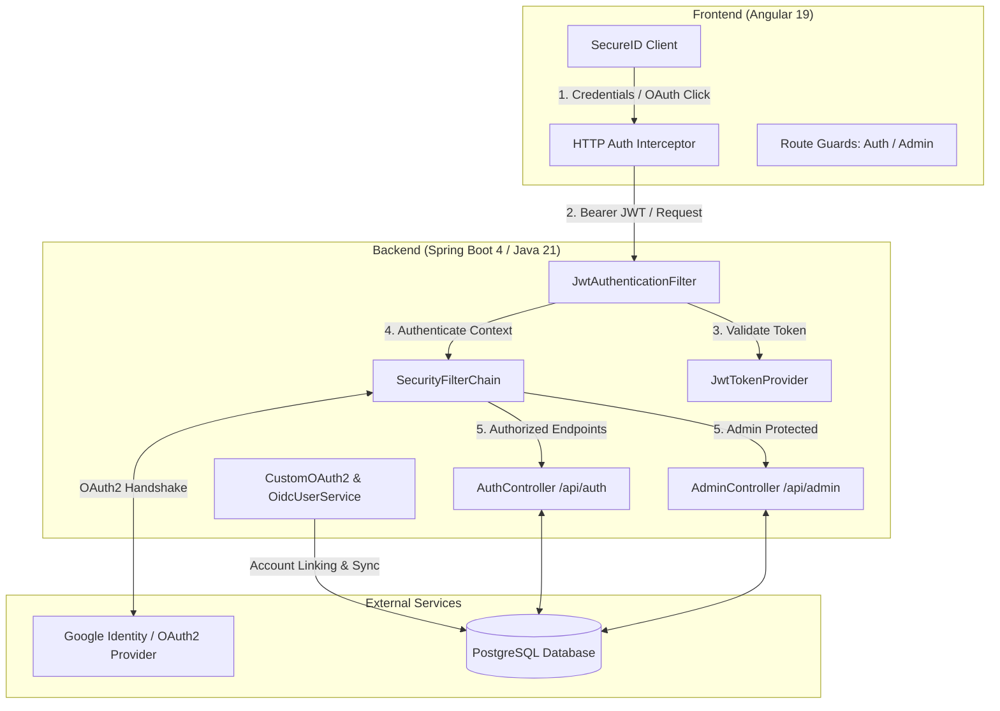

# 🛡️ SecureID — Production-Grade Authentication & Authorization System

A robust, enterprise-ready full-stack authentication and authorization system built with **Spring Boot 4**, **Java 21**, **Angular 19**, **PostgreSQL**, **Google OAuth2 / OIDC**, and **Stateless JWT Tokens**.

---

## 🌟 Key Features

- **Dual Authentication Strategies**:
  - **Local Authentication**: Secure email/password registration and login with BCrypt password hashing.
  - **Social Authentication**: Google OAuth2 & OpenID Connect (OIDC) single sign-on.
- **Seamless Account Linking**: Automatically links Google OAuth credentials to existing local email accounts without duplicate database rows or authentication collisions.
- **Stateless JWT Architecture**: High-performance, cryptographically signed JSON Web Tokens (`HMAC-SHA256` via JJWT `0.12.6`) with automated bearer token extraction and validation filter.
- **Cookie-Based OAuth2 Authorization State**: Replaces vulnerable in-memory HTTP session state with short-lived, secure HTTP cookies for OAuth2 authorization requests (`state` and `redirect_uri`).
- **Role-Based Access Control (RBAC)**:
  - Granular permissions with `ROLE_USER` and `ROLE_ADMIN`.
  - Spring Security Method-level security (`@PreAuthorize("hasRole('ADMIN')")`).
  - Frontend route protection with Angular Functional Guards (`authGuard`, `guestGuard`, `adminGuard`).
- **Modern Light-Themed Angular 19 Frontend**:
  - Standalone Components with Angular Signals for reactive state management.
  - Responsive navigation bar with dynamic session controls and user greeting.
  - User Dashboard with profile info, authentication provider badges, and role indicators.
  - Full Admin Management Console: Live system user metrics, user directory, real-time role promotion/demotion, and user account deletion.
- **Production Safety**:
  - Environment-based configuration with fallback defaults.
  - Sensitive credential isolation (`application-local.properties` gitignored).

---

## 🏛️ System Architecture



---

## 🔐 Authentication Flows

### 1. Local Registration & Login Flow
1. User registers via `/api/auth/signup` with name, email, and password.
2. Password is encrypted using `BCryptPasswordEncoder` (10 rounds).
3. Upon login (`/api/auth/login`), credentials are verified by `AuthenticationManager`.
4. A signed JWT containing user ID, email, and roles is generated and returned to the client.
5. Angular stores the token in `localStorage` and attaches it to subsequent requests via `authInterceptor`.

### 2. Google OAuth2 / OIDC Flow
1. User clicks **"Continue with Google"** on frontend, navigating to `/oauth2/authorize/google?redirect_uri=http://localhost:4200/oauth2/redirect`.
2. Backend intercepts the request, saves authorization state in an encrypted short-lived cookie, and redirects user to Google's consent screen.
3. User authenticates with Google; Google redirects back to Spring Boot callback: `/login/oauth2/code/google`.
4. `CustomOidcUserService` processes user information:
   - If user doesn't exist: A new `User` record is created with `AuthProvider.GOOGLE`.
   - If user exists as `LOCAL`: Seamlessly links the Google provider ID and updates profile image/name.
5. `OAuth2AuthenticationSuccessHandler` creates an application JWT and redirects to the Angular frontend:
   `http://localhost:4200/oauth2/redirect?token=<JWT>`.
6. Angular `OAuth2RedirectComponent` captures the token, stores it, fetches profile details, and routes to `/dashboard`.

---

## 🛠️ Tech Stack

### Backend
- **Framework**: Spring Boot 4.2.0
- **Language**: Java 21
- **Security**: Spring Security 6 / Spring OAuth2 Client
- **JWT**: JJWT (`io.jsonwebtoken:jjwt-api:0.12.6`)
- **Database**: PostgreSQL 16+
- **Persistence**: Spring Data JPA & Hibernate
- **Build Tool**: Apache Maven 3.9+

### Frontend
- **Framework**: Angular 19 (Standalone Components)
- **State Management**: Angular Signals (`signal`, `computed`)
- **Routing**: Angular Router with Functional Guards
- **HTTP**: `provideHttpClient` with functional `authInterceptor`
- **Styling**: Modern responsive CSS / CSS Flexbox & Grid

---

## 🚀 Getting Started

### Prerequisites
- **Java 21 JDK** installed
- **Node.js 20+** and **npm** installed
- **PostgreSQL** running locally on port 5432
- **Google Cloud Console OAuth 2.0 Client ID**

---

### Backend Setup

1. **Navigate to the backend directory**:
   ```bash
   cd backend
   ```

2. **Configure Database**:
   Create a PostgreSQL database named `spring_auth_db`:
   ```sql
   CREATE DATABASE spring_auth_db;
   ```

3. **Configure Secrets**:
   Create `backend/src/main/resources/application-local.properties` (or set environment variables):
   ```properties
   spring.datasource.password=your_postgres_password
   spring.security.oauth2.client.registration.google.client-id=your_google_client_id
   spring.security.oauth2.client.registration.google.client-secret=your_google_client_secret
   ```

4. **Run the Backend**:
   ```bash
   ./mvnw spring-boot:run
   ```
   Backend will start on `http://localhost:8080`.

---

### Frontend Setup

1. **Navigate to the frontend directory**:
   ```bash
   cd frontend
   ```

2. **Install Dependencies**:
   ```bash
   npm install
   ```

3. **Start Development Server**:
   ```bash
   npm start
   ```
   Open `http://localhost:4200` in your browser.

---

## 📡 API Reference

### Public Authentication (`/api/auth/**`)
| Method | Endpoint | Description | Access |
|---|---|---|---|
| `POST` | `/api/auth/signup` | Register new user account | Public |
| `POST` | `/api/auth/login` | Authenticate with email/password | Public |
| `GET` | `/oauth2/authorize/google` | Initiate Google OAuth2 login | Public |

### User Profile (`/api/user/**`)
| Method | Endpoint | Description | Access |
|---|---|---|---|
| `GET` | `/api/user/me` | Fetch authenticated user profile | Authenticated |

### Admin Management (`/api/admin/**`)
| Method | Endpoint | Description | Access |
|---|---|---|---|
| `GET` | `/api/admin/stats` | System metrics (total users, providers) | Admin Only |
| `GET` | `/api/admin/users` | List all registered users | Admin Only |
| `PUT` | `/api/admin/users/{id}/role` | Update user role (`ROLE_USER` / `ROLE_ADMIN`) | Admin Only |
| `DELETE` | `/api/admin/users/{id}` | Permanently delete user | Admin Only |

---

## 🔒 Security Best Practices Implemented

- **BCrypt Password Hashing**: Passwords stored as irreversible salted hashes.
- **CSRF Cookie Protection**: Secure state tokens used during OAuth2 redirects.
- **Strict CORS Policy**: Restricted to authorized client origin (`http://localhost:4200`).
- **Stateless Session Management**: `SessionCreationPolicy.STATELESS` ensures zero server session hijacking surface.
- **Secrets Isolation**: Gitignore rules prevent credential leaks.

---

## 📄 License
This project is licensed under the MIT License - feel free to use and modify for your own projects!
